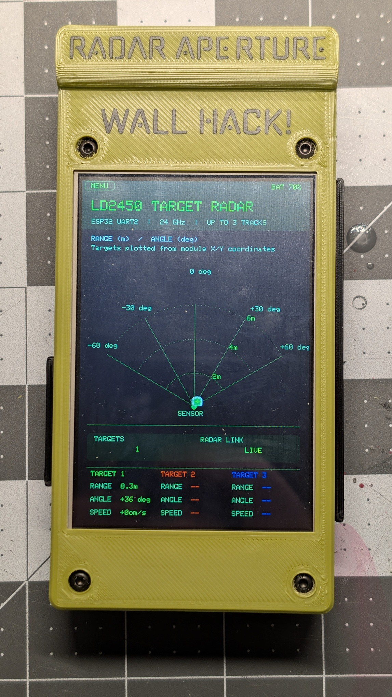
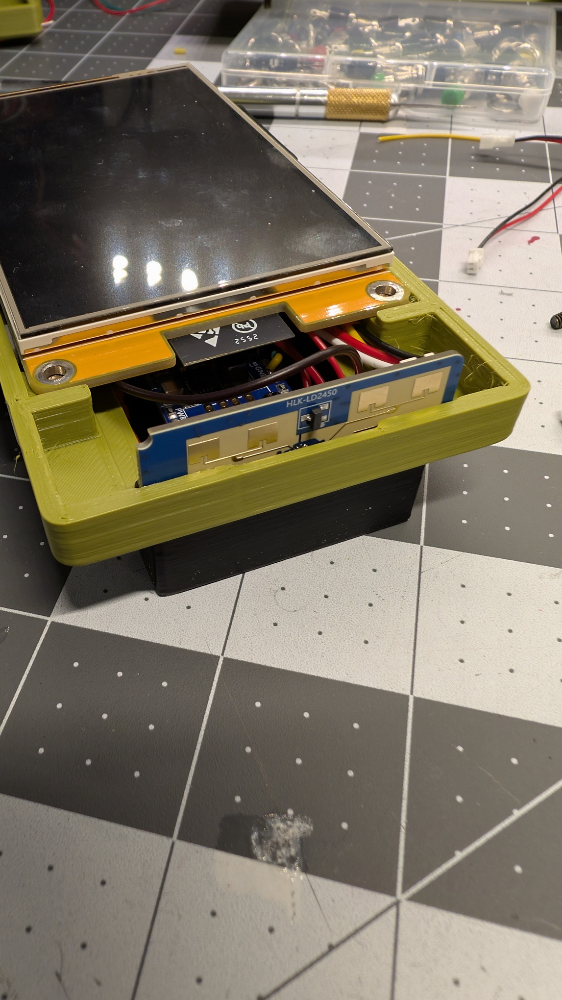
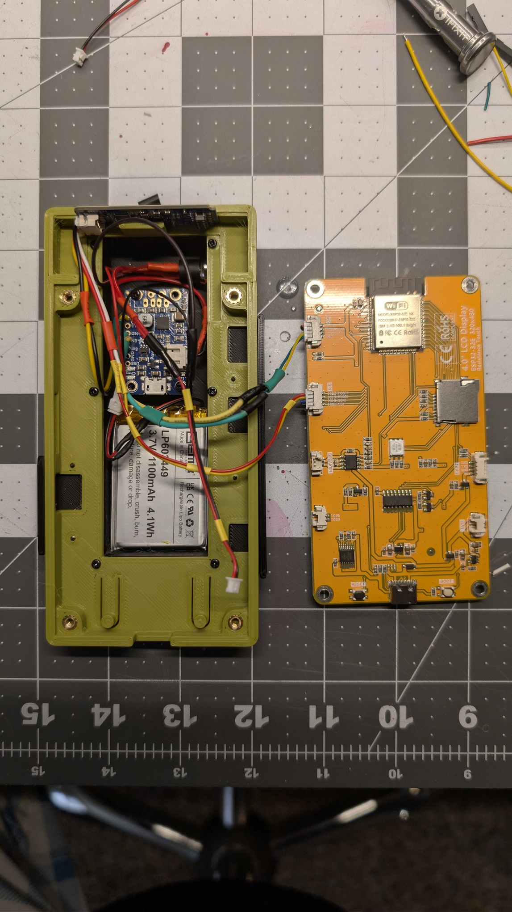

# wall-hack

Handheld presence detector using an LD2450 24GHz radar module and the
LCDWiki 4.0-inch ESP32-32E (E32R40T) display.

## Assembled hardware

  
   <em>Front view with the radar interface running.</em>

  
   <em>Open enclosure showing the LD2450 mounted behind the display.</em>

  
   <em>Battery and internal wiring alongside the rear of the LCDWiki board.</em>

## Firmware

**Version: v1.0**

`radar_firmware/radar_firmware.ino` is the current
v1.0 display and radar firmware baseline. At startup, the sketch reports its
firmware version over USB serial. It draws a portrait radar view with a 15-pixel
status bar, battery estimate, and a menu containing the Shut Down action.
The LD2450 reports up to three moving targets with range, angle, and velocity.
Target colors are green, red, and blue for targets 1, 2, and 3.

## Hardware

### Main board and display

- LCDWiki 4.0-inch ESP32-32E board, model E32R40T
- 320x480 ST7796S display with onboard XPT2046 touch controller
- Onboard display wiring: CS GPIO15, DC GPIO2, SCLK GPIO14, MOSI GPIO13,
  MISO GPIO12, reset shared with ESP32 EN, and active-high backlight GPIO27
- Configure TFT_eSPI with the E32R40T `Setup_E32R40T.h` setup. Select the
  original ESP32 Dev Module board; 4 MB flash and PSRAM disabled are the
  documented Arduino IDE settings.

### LD2450 and power wiring

| Connection | Board pin |
| --- | --- |
| LD2450 TX (radar output) | GPIO19, UART2 RX |
| LD2450 RX (radar input) | GPIO23, UART2 TX |
| LD2450 power | PowerBoost 500C 5V output |
| PowerBoost EN | GPIO25, HIGH enables / LOW disables |
| Battery ADC | GPIO34 |
| Ground | Common ground |

UART2 runs at 256000 baud. GPIO19 and GPIO23 are also used by the board's
microSD SPI interface, so leave the SD card disconnected while the radar is
connected.

The touch calibration is stored in Preferences under a portrait-specific
profile. The first boot runs the TFT_eSPI calibration screen; send `c` over USB
serial to recalibrate. Touch coordinates are printed to USB serial.

## Shutdown

Choose **MENU > Shut Down** to stop UART2, put the radar UART pins into
high-impedance mode, drive PowerBoost EN low and hold it there, put the TFT to
sleep, turn off its backlight, and enter ESP32 deep sleep. Press RESET to
restart.

During earlier bench testing, the user measured about 1.2V remaining at the
boost output with the radar connected even after EN was pulled low. Each UART
data line contributed about half of that voltage. A hard battery switch is the
current workaround; verify power behavior on the assembled device.

## Battery and power notes

GPIO34 battery sensing uses an assumed 2.0x divider and an uncalibrated ADC
scale. The displayed percentage is a rough voltage-based estimate, not a
measured state of charge. It does not measure charging current, completion, or
battery temperature.

Do not connect the LCDWiki charger and PowerBoost charger to the same cell
without validating the power-path design. Measure cell voltage/current and
awake/sleep current before relying on charge or runtime estimates.
